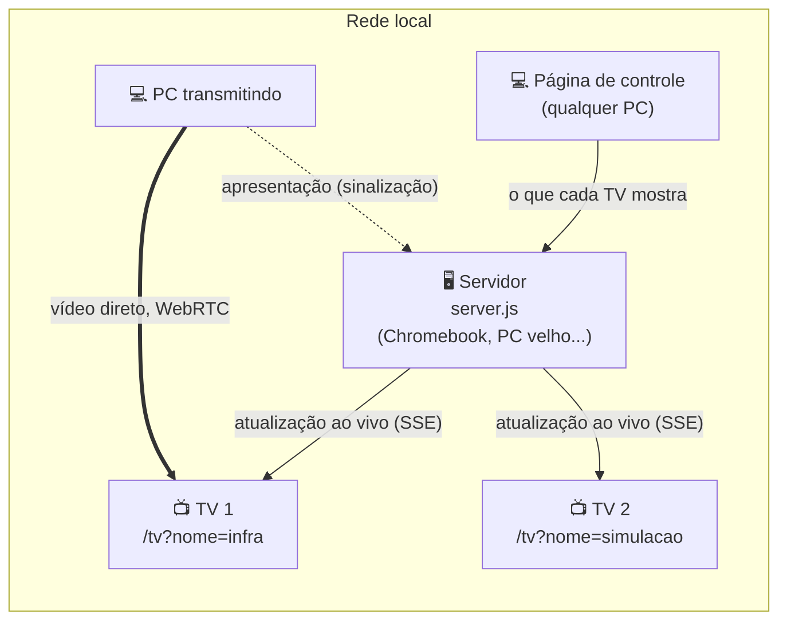

# 📺 Painel das TVs

**Transforme TVs com navegador em painéis de escritório e telões de apresentação — sem cabos, sem aplicativo na TV e sem comprar nada.**

Um único arquivo `server.js` (Node 18+, **zero dependências**) roda num computador qualquer da rede — no meu caso, um Chromebook velho. As TVs abrem uma página. Uma página de controle, aberta em qualquer PC, decide o que cada TV mostra. E qualquer pessoa pode transmitir a tela do PC ao vivo pra uma TV, direto pela rede local.

> 🇺🇸 **In English:** a zero-dependency Node.js server that turns browser-capable smart TVs (tested on LG webOS) into office dashboards. Each TV shows one or two websites side by side, controlled from a web page, and anyone can stream their PC screen live to a TV over the local network via WebRTC. Includes a reverse proxy that makes login-protected sites work inside the TV's iframes, and a measurement-driven fix for WebRTC stutter on smart TVs. Built during my internship, pair-programmed with AI (Claude): the AI proposed and implemented, I defined, tested on the real TVs and decided. Docs are in Portuguese.

---

## O que ele faz

| | |
|---|---|
| 🖥️ **Painéis** | Cada TV mostra um site em tela cheia ou dois lado a lado, com zoom ajustável. Trocar o que aparece leva um clique na página de controle — a TV atualiza na hora, sem ninguém encostar no controle remoto. |
| 📡 **Transmissão de tela** | Qualquer pessoa transmite a tela do PC pra uma TV, ao vivo, pelo navegador (WebRTC, PC → TV direto). Duas TVs, duas pessoas transmitindo ao mesmo tempo. Quando para, a TV volta sozinha pro painel. |
| 🔐 **Sites com login** | Dentro de um `iframe`, o navegador da TV recusa o cookie de login. Um intermediário (proxy reverso) faz o site parecer "da casa" pra TV, e o login funciona dentro do painel. |
| 📊 **Diagnóstico embutido** | A transmissão mede tudo, dos dois lados: quadros gerados, enviados e recebidos, fila de saída, rede, buffer, congelamentos. Um registro da sessão mostra onde está o gargalo — e foi assim que os problemas difíceis foram resolvidos. |
| 🛡️ **Feito pra ficar ligado** | Recarga diária de madrugada, reconexão automática, transmissão "presa" encerrada sozinha, proteção de tela da TV desligada sem mexer no menu dela. |

## Como funciona, em uma imagem



O servidor só **coordena**: guarda o que cada TV mostra e apresenta o PC à TV. O vídeo da transmissão vai **direto do PC pra TV**, sem passar por ele — por isso um Chromebook dá conta.

## Começando em 1 minuto

```bash
git clone https://github.com/eggdraz/tv-dashboard-webrtc.git
cd tv-dashboard-webrtc
node server.js
```

| Quem | Abre |
|---|---|
| Página de controle | `http://<ip-do-servidor>:8080/` |
| Cada TV (no navegador dela) | `http://<ip-do-servidor>:8080/tv?nome=infra` |
| TV de teste, em qualquer PC | `http://<ip-do-servidor>:8080/tv?nome=teste` |

Pra transmitir a tela, o Chrome de quem transmite precisa liberar o endereço uma vez — veja [Instalação → Transmissão de tela](docs/instalacao.md#transmissão-de-tela-uma-vez-por-pc).

## Documentação

| Guia | O que tem |
|---|---|
| [**Instalação**](docs/instalacao.md) | Linux, Chromebook (com as armadilhas do ChromeOS), TVs, subir sozinho no boot |
| [**Arquitetura**](docs/arquitetura.md) | Componentes, fluxos, rotas HTTP, eventos e o estado salvo |
| [**Transmissão de tela**](docs/transmissao.md) | Como o WebRTC foi ajustado e a investigação das travadas, com os números medidos |
| [**Sites com login**](docs/sites-com-login.md) | O intermediário (proxy reverso) e o modo de navegador no servidor |
| [**Problemas comuns**](docs/problemas-comuns.md) | Sintoma → causa → solução |

## Destaques técnicos

Alguns problemas que pareciam simples e não eram — cada um resolvido medindo, não chutando:

- **Vídeo travando com a rede perfeita.** Zero pacotes perdidos, e mesmo assim a TV congelava. O registro mostrou que toda travada vinha logo depois de a tela do PC ficar parada: o Chrome só manda quadro quando a tela muda, e o player da TV "dormia" nas pausas. A solução é um relógio num Web Worker que mantém 30 quadros/s constantes, com carimbo de tempo da agenda. [→ a investigação completa](docs/transmissao.md)
- **4 segundos de atraso que não eram da rede.** O codificador H.264 por hardware de alguns PCs ignora o limite de banda; o excesso vira uma fila de mais de 1 s *dentro do próprio PC*. Com VP8, que respeita o limite: fila zero.
- **Vídeo começando em 320×180.** O VP8 não tem linha `a=fmtp` no SDP, então as instruções de banda inicial nunca chegavam. A correção cria a linha.
- **Login que funciona em tela cheia, mas não no painel.** Cookies de terceiros bloqueados dentro do `iframe`. O intermediário traduz cookies `__Secure-`/`__Host-`, endereços (inclusive escapados em JSON e codificados em URL), `Origin`/`Referer` e até o corpo do formulário de login. [→ como funciona](docs/sites-com-login.md)
- **Painel logado, mas sem dados.** O site buscava os dados em outro servidor, que só aceita pedidos do endereço original (CORS). O intermediário passou a encaminhar esse servidor também, no mesmo endereço.
- **TV entrando em proteção de tela.** A TV não deixa desligar isso no menu. Um vídeo mudo de 1,5 KB e 2 pixels, em loop, faz ela achar que tem vídeo tocando — e pausa durante a transmissão pra não ocupar o decodificador.

## Estrutura

```
server.js              servidor HTTP, sinalização WebRTC, intermediário, estado (~1.400 linhas)
public/controle.html   página de controle: painéis, transmissão, medidas e registro
public/tv.html         página que cada TV abre: painéis e recepção do vídeo
public/acordada.mp4    vídeo de 1,5 KB contra a proteção de tela da TV
iniciar-painel.sh      sobe o servidor em segundo plano (Linux)
painel-tv.desktop      atalho no menu de apps pro script acima
docs/                  documentação
```

Sem build, sem framework, sem `npm install`: HTML, CSS e JavaScript puros, e o servidor usa só módulos nativos do Node (`http`, `https`, `zlib`, `crypto`, `child_process`).

## Compatibilidade

| Testado em | Situação |
|---|---|
| LG webOS (navegador da TV) | ✅ painéis, transmissão, sites com login |
| Chrome / Edge no Windows (quem transmite) | ✅ |
| Servidor no Linux do ChromeOS (Crostini) | ✅ com [cuidados](docs/instalacao.md#no-chromebook-linux-do-chromeos) |
| Servidor em Linux comum | ✅ o caso mais simples |

Outras TVs com navegador baseado em Chromium devem funcionar; não foram testadas.

## Como foi feito

Projeto do meu estágio, a partir de uma necessidade real: duas TVs paradas, um Chromebook sobrando e nenhum orçamento. Está em uso no dia a dia da equipe.

O código foi escrito **em par com IA (Claude)**: a IA propunha soluções e implementava; eu definia o que fazer, testava e decidia. Na prática, a minha parte foi:

- **Definir o problema e as restrições** — sem cabos, sem compra, sem instalar nada nas TVs — e escolher entre as alternativas (Miracast, Google Cast, Raspberry Pi, WebRTC no navegador).
- **Testar nas TVs de verdade**, com a equipe usando, e trazer os dados de volta. Várias falhas só apareciam na TV e nunca no navegador do PC.
- **Conduzir a investigação** das travadas e do atraso: exigir medidas antes de cada correção, pedir o registro da sessão pra comparar o que o PC envia com o que a TV recebe, e recusar correções que não se provavam nos números.
- **Simplificar** — cortar opções que confundiam quem usava, até sobrar um modo de transmissão só.
- **Operar em produção** — instalar e manter o servidor no Chromebook, lidar com mudanças de rede e de IP.

A regra que mais fez diferença: **nenhuma mudança ia pras TVs sem ser testada antes**.

O que aprendi no caminho: como o WebRTC funciona por dentro (SDP, ICE, codificadores, estatísticas de envio e recepção), como cookies e CORS se comportam entre sites, e — principalmente — que medir antes de corrigir economiza dias.

## Licença

[MIT](LICENSE) — pode usar, copiar e modificar, mantendo o aviso de autoria.
