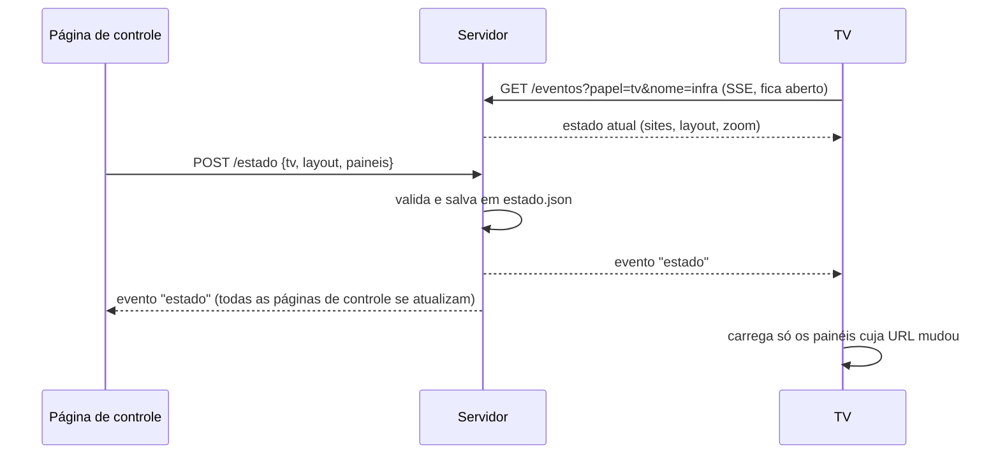

# Arquitetura

Três peças, todas em JavaScript puro:

| Peça | Arquivo | Roda em |
|---|---|---|
| Servidor | `server.js` | Uma máquina da rede (Node 18+) |
| Página da TV | `public/tv.html` | Navegador de cada TV |
| Página de controle | `public/controle.html` | Navegador de quem controla ou transmite |

## Princípios

- **O servidor coordena, não carrega.** Ele guarda o estado e faz a apresentação entre PC e TV. O vídeo da transmissão e os sites dos painéis vão direto pro navegador da TV. Por isso um Chromebook de entrada dá conta.
- **Zero dependências.** Só módulos nativos do Node. Instalar é copiar a pasta.
- **A TV não tem botões.** Tudo que ela faz é comandado pela página de controle; ninguém precisa encostar no controle remoto.
- **Falhar de forma visível e se recuperar sozinho.** Servidor fora do ar, TV desconectada, transmissão que morreu: cada caso tem aviso na tela e volta ao normal sem intervenção.

## Painéis



- **Server-Sent Events** em vez de WebSocket: o navegador reconecta sozinho, e não precisa de biblioteca nenhuma dos dois lados.
- A TV só recarrega um painel se a URL **carregada nele** mudou — comparar com o estado anterior falhava ao dividir a tela (o painel da direita podia estar no estado sem nunca ter sido carregado).
- Cada painel é um `iframe` renderizado maior e escalado por `transform`, que é como o zoom funciona sem depender do site.
- Se o site bloqueia ser exibido em quadro (`X-Frame-Options`/CSP), a TV mostra um aviso com o botão "Abrir o site direto" depois de 20 s.

## Transmissão de tela

```mermaid
sequenceDiagram
    participant P as PC (controle)
    participant S as Servidor
    participant T as TV
    P->>P: getDisplayMedia (captura a tela)
    P->>S: POST /sinal {tipo: oferta, tv, sdp}
    S->>S: TV livre? marca o PC como dono da TV
    S-->>T: evento "oferta"
    T->>S: POST /sinal {tipo: resposta, para, sdp}
    S-->>P: evento "resposta"
    P-->>T: candidatos ICE (pelo servidor)
    P==>>T: vídeo direto (WebRTC)
    loop a cada 2 s
        T->>S: medidas da TV (repassadas ao PC)
        P->>S: POST /medidas (lado do PC)
    end
```

- **Só candidatos locais** (`iceServers: []`): na mesma rede, não precisa de STUN/TURN, e nada depende de internet.
- **Uma transmissão por TV**, várias TVs ao mesmo tempo. O servidor recusa a segunda pessoa na mesma TV.
- **Nada fica preso:** se o PC fecha a aba, a TV desliga, ou a TV para de mandar medidas por 20 s, o servidor encerra a transmissão e avisa os dois lados.
- O servidor avisa quando PC e TV estão em redes diferentes (compara as faixas de IP).

Detalhes do vídeo e da investigação de travadas: [transmissao.md](transmissao.md).

## Rotas HTTP

| Rota | Método | Pra quê |
|---|---|---|
| `/` | GET | Página de controle |
| `/tv?nome=<id>` | GET | Página da TV |
| `/config` | GET | Lista de TVs, atalhos, intermediários, estado e quem está transmitindo |
| `/eventos?papel=tv&nome=<id>` | GET | SSE da TV |
| `/eventos?papel=controle` | GET | SSE da página de controle (recebe eventos de todas as TVs) |
| `/estado` | POST | Muda o que uma TV mostra |
| `/recarregar` | POST | Recarrega a página de uma TV |
| `/sinal` | POST | Sinalização WebRTC: `oferta`, `resposta`, `ice`, `parar`, `stats` |
| `/medidas` | POST | Medidas do lado do PC durante a transmissão |
| `/diagnostico` | GET | Últimas medidas de cada TV (PC e TV) |
| `/diagnostico?historico=<id>` | GET | Histórico das últimas 300 medidas de uma TV |
| `/remoto/*` | GET/POST | Modo de navegador no servidor (imagem, tamanho, cliques) |
| `/acordada.mp4` | GET | Vídeo contra a proteção de tela |

## Eventos (SSE)

| Evento | Pra quem | Quando |
|---|---|---|
| `bemvindo` | todos | Ao conectar; traz o `id` usado pra rotear a sinalização |
| `estado` | TV e controles | O que a TV mostra mudou |
| `presenca` | controles | Uma TV conectou ou desconectou |
| `compartilhando` | controles | Alguém começou/parou de transmitir numa TV |
| `oferta`, `resposta`, `ice`, `parar` | o PC ou a TV envolvidos | Sinalização WebRTC |
| `stats` | o PC que transmite | Medidas da TV, a cada 2 s |
| `recarregar` | TV | Pedido de recarga |

## Estado salvo

`estado.json`, uma entrada por TV:

```json
{
  "infra": {
    "layout": 2,
    "paineis": [
      { "titulo": "Monitoramento", "url": "https://...", "zoom": 0.7, "modo": "site" },
      { "titulo": "Sistema interno", "url": "https://app.exemplo.com/dashboard", "zoom": 0.7,
        "modo": "intermediario", "porta": 8081 }
    ]
  }
}
```

| `modo` | Como o painel carrega |
|---|---|
| `site` | `iframe` direto com a URL |
| `intermediario` | `iframe` apontando pro intermediário, na porta dele ([sites com login](sites-com-login.md)) |
| `remoto` | Imagem de um Chromium rodando no servidor ([alternativa](sites-com-login.md#alternativa-navegador-no-servidor)) |

## Robustez da página da TV

- **Servidor fora do ar:** aviso discreto no canto; o SSE reconecta sozinho e o conteúdo volta.
- **Recarga diária às 4h:** navegador de TV aberto por dias acumula memória. Só recarrega se o servidor estiver respondendo (senão a TV ficaria numa página de erro) e nunca no meio de uma transmissão.
- **Durante a transmissão:** os painéis são descarregados (sites escondidos continuavam rodando e disputavam o processador fraco da TV) e voltam no fim.
- **Proteção de tela:** um vídeo mudo de 1,5 KB toca em loop, quase invisível; pausa durante a transmissão.
- **Cursor:** aparece ao mexer o controle e some depois de 4 s.
